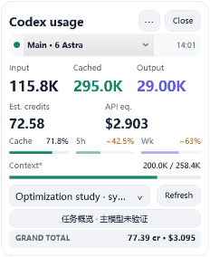
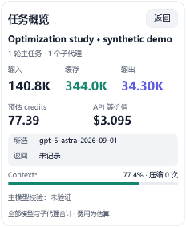

# Codex Token Monitor 1.3.8

[English](README.en.md) · 独立社区工具 · MIT License

以下预览使用自动生成的合成日志：

 

源码仓库使用 .NET 8 SDK。编译产物位于 `artifacts/publish/framework-dependent/`，由发布脚本生成；下载源码后先构建，Release 包才直接提供 EXE。

## 路径与便携使用

程序搬到其他目录或换一台电脑后，会自动使用那台电脑当前用户的 `.codex` 和本地应用数据目录，不依赖开发者的用户名、桌面位置或盘符。支持 `CODEX_HOME`，不创建或迁移 Codex 日志。

```powershell
# 数据目录非默认位置时指定 .codex 根目录
.\CodexTokenMonitor.exe '--codex-home=D:\CodexData'
# 或仅指定独立 sessions 目录；索引和模型日志从其父目录查找
.\CodexTokenMonitor.exe '--sessions=D:\CodexData\sessions'
# 仅把小组件设置放在 EXE 旁边 data/settings.json
.\CodexTokenMonitor.exe --portable
# 输出解析后的路径及存在状态，不读取日志正文或认证
.\CodexTokenMonitor.exe '--diagnose-paths=paths.json'
```

命令行路径还支持 `--settings=...` 与 `--model-log=...`。对应环境变量为 `CODEX_TOKEN_MONITOR_SETTINGS_PATH`、`CODEX_TOKEN_MONITOR_MODEL_LOG_PATH`；sessions 对应 `CODEX_TOKEN_MONITOR_SESSION_ROOT`。空白环境变量使用默认值。路径支持 `~`、`%变量名%`、`$变量名`、`${变量名}`；相对路径始终按 **EXE 所在目录** 解析，与启动时的工作目录无关。PowerShell 中含 ` 的字面路径请使用单引号。

命令行选项优先于环境变量。明确指定 `--codex-home` 时，若没有 `--sessions`，会使用所指定根目录内的 sessions；`--settings` 优先于 `--portable`。修改仅在当前进程生效，不改系统环境或 Codex 配置。便携设置要求 EXE 所在位置可写；日志仍留在原数据目录。

找不到 sessions 时显示等待状态；创建首个 Codex 会话后可按 F5 重新连接监听。WSL/Linux 的数据需要通过 Windows 可访问路径明确指定，WPF 界面仅支持 Windows。日志目录和内部 SQLite 格式可能随 Codex 更新变化，不承诺自动识别所有版本。

诊断 JSON 会含本机路径，分享前检查。公开截图只使用合成测试数据。

## 从仓库构建

安装 .NET 8 SDK，从仓库根目录运行（脚本也能从其他工作目录调用）：

```powershell
.\scripts\Build.ps1
.\scripts\Test.ps1
.\scripts\Publish.ps1
# 可选：带 .NET 运行时的发布包，需要下载官方运行时包
.\scripts\Publish.ps1 -SelfContained -Runtime win-x64
```

默认发布目录是 `artifacts/publish/framework-dependent/`，运行需 .NET 8 Desktop Runtime；自包含发布无需另装运行时。不要只复制 EXE。脚本通过自身位置查找项目，不含开发机器绝对路径。Windows GitHub Actions 会构建、运行模拟测试并提供构建产物。

贡献方式见 [CONTRIBUTING.md](CONTRIBUTING.md)。

原生 Windows WPF 用量小组件。双击 `CodexTokenMonitor.exe` 启动，无需管理员权限。运行需要 Windows 10/11 和 .NET 8 Desktop Runtime；请保留同目录的 DLL、deps.json、runtimeconfig.json 与 EXE。

## 使用

主界面和任务概览均为 232 × 284 逻辑像素。模型菜单可切换 Main / Agents 的模型统计，任务菜单默认显示最近 5 个任务；展开后可按名称或编号搜索本地历史任务。长标题省略显示，悬停查看完整名称。关闭搜索后释放完整搜索列表，只保留最近任务。

`Refresh` 或 F5 手动刷新，并尝试恢复断开的日志监听；`任务概览` 查看关键汇总及模型校验；顶部 `⋯` 提供置顶和“显示剩余额度”开关，标题栏可拖动。概览点击“返回”或按 Esc 关闭，预估 credits 的悬停提示显示主任务/子代理费用拆分。

额度默认显示已用百分比；开启“显示剩余额度”后，数字和进度条一起改为剩余比例，并记住选择。已用达到 90% 时显示红色；快照超过 15 分钟时添加 `~` 并淡化进度条，悬停可查看记录时间。未知或已到期的数据仍显示 `--`。顶部状态点表示本地日志读取与监听状态：绿为正常、灰为等待任务、黄为监听未连接、红为读取失败，不表示任务是否正在运行。没有新增重置按钮或倒计时。

不提供导出功能，不创建独立的用量历史文件，不再保留每轮提示摘要。内存只保留所选任务及其子代理的统计记录、增量读取状态和必要元数据，切换任务后释放原任务的解析缓存；无任务标题时只保留一段最多约 100 字符的首条消息作为标题备用。

程序通过文件变更事件更新，750ms 合并突发写入，没有空闲日志轮询。快照陈旧或到期时仅定时更新界面。默认读取 `%USERPROFILE%\.codex\sessions` 与 `session_index.jsonl`，设置 `CODEX_HOME` 时读取该目录。窗口位置、置顶和额度显示偏好保存在 `%LOCALAPPDATA%\CodexTokenMonitor\settings.json`。程序不修改 Codex 日志、配置，不读取认证文件，也不发起网络请求。

## 模型名称校验

“所选”读取当前轮次 `turn_context.model` 或 `thread_settings_applied.thread_settings.model`。“返回”仅接受明确的 `model_reroute` 事件或运行日志中的 `server reported model` 记录。通过 Windows 自带 SQLite 只读查询 Codex 根目录下的 `logs_2.sqlite` 与 `sqlite/logs_2.sqlite`，限定当前主任务、同一轮次及当前模型请求时间之后的最新可用回报。

结果分为“未验证 / 名称一致 / 名称不同”。未记录、数据库缺失、锁定或格式不支持时显示“未验证”，不把请求模型当作返回模型。日志可能不保留回报，未发现差异不等于已验证一致。名称校验不能判断回答质量或账户是否被降级，也不能代表整个任务的每次调用；费用仍按逐轮请求模型估算。状态随会话刷新或手动刷新更新，不额外轮询数据库。

## 数字含义

| 显示 | 口径 |
| --- | --- |
| Input | 所选模型累计未缓存输入，包含缓存写入 |
| Cached | 所选模型累计缓存读取输入；原始 input_tokens 已包含这部分 |
| Output | 所选模型累计输出，已包含 Reasoning，不能再次相加 |
| Cache | 缓存读取输入 / 总输入 |
| Est. credits / API eq. | 根据本地日志与内置费率估算的 credits / API 等价值 |
| 5h / Wk | 账户对应窗口的**已使用百分比**，不是当前任务百分比；开启剩余模式后标签为 `5h余 / 周余`，显示 **100% − 已用比例** |
| Context* | 当前主任务**最近一次请求输入量 / 日志报告的上下文窗口**；不是累计 token，也不是实时上下文占用；悬停查看记录时间 |
| TOTAL / GRAND TOTAL | 当前任务全部模型合计；有子代理时包括子代理。`≥` 表示含费率未知的记录，显示的是已知部分 |

任务概览显示全部模型与子代理的合计，预估费用的悬停提示保留主任务与子代理的费用拆分。

## 费率与限制

内置参考费率核对日期：2026-10-02，单位为每百万 token。下表为 Standard 短上下文参考价；历史日志也按这张当前费率表重新估算，不用于还原历史账单。

| 模型 | Credits 输入 / 缓存 / 输出 | API 美元输入 / 缓存 / 输出 |
| --- | --- | --- |
| GPT-6 Astra | 250 / 25 / 1250 | 10 / 1 / 50 |
| GPT-6.1 Sol | 50 / 2.5 / 250 | 2 / 0.1 / 10 |
| GPT-6 Sol | 50 / 5 / 250 | 2 / 0.2 / 10 |
| GPT-6 Luna | 2.5 / 0.25 / 12.5 | 0.1 / 0.01 / 0.5 |
| GPT-5.6 Sol | 100 / 10 / 500 | 4 / 0.4 / 20 |
| GPT-5.6 Terra | 50 / 5 / 300 | 2 / 0.2 / 12 |
| GPT-5.6 Luna | 5 / 0.5 / 30 | 0.2 / 0.02 / 1.2 |
| GPT-5.5 | 125 / 12.5 / 750 | 5 / 0.5 / 30 |
| GPT-5.4 | 62.5 / 6.25 / 375 | 2.5 / 0.25 / 15 |
| GPT-5.4 mini | 18.75 / 1.875 / 113 | 0.75 / 0.075 / 4.50 |

GPT-6.1 Sol、GPT-6 Astra / Sol / Luna 和 GPT-5.6 Sol / Terra / Luna 的 API 等价值按单次请求处理超过 272,000 输入 token 时的倍率：输入及缓存 ×2，输出 ×1.5。日志明确标记 priority / fast 时，这七个模型按官方购入 credits / Enterprise 按量计费口径 ×2、API ×2；flex / batch 时 API ×0.5。Astra 日志明确标记 ultrafast 时，credits 和 API 均 ×6，并与长上下文倍率叠加。其他模型的 Ultrafast 费率未公布时显示费率未知，合计只显示已知部分。速度档位缺失时按 Standard 估算。这七个模型的 API 缓存写入按输入费率 ×1.25；credits 没有单独缓存写入类别，按普通输入参考。旧版 GPT-5.5 / GPT-5.4 系列仍按表中 Standard 基础价估算。

订阅包含的额度消耗与购入 credits 计费不同：官方 Fast 额度消耗 ×2.5，Astra Ultrafast ×8；这些倍率不用于本程序的 Est. credits，也不推算每个任务的周额度。账户 5h / 周额度继续显示日志里的实际快照。没有给订阅长上下文自行添加未经确认的倍率。

费率来源：[Codex credits](https://learn.chatgpt.com/docs/pricing#token-rates)、[API 价格表](https://developers.openai.com/api/docs/pricing)、[Codex 速度倍率](https://learn.chatgpt.com/docs/agent-configuration/speed)、[GPT-6.1 Sol](https://developers.openai.com/api/docs/models/gpt-6.1-sol)、[Astra Ultrafast](https://developers.openai.com/api/docs/guides/ultrafast-mode)。GPT-6.1 Sol 的输入和输出标准价与 GPT-6 Sol 相同，缓存读取价格降低 50%。GPT-5.6 Sol 使用官方当前公布的促销费率（至少持续至 2026-11-21）。官方未承诺价格永远不变，程序不会再额外打五折，也不会到期自动猜测恢复价。费率不会自动联网更新，后续可修改 `PricingCatalog.cs` 并重新编译。

**这些估算不等于订阅实际扣费或额度消耗。** 订阅额度请以 Codex 官方显示为准。本地日志可能缺少速度档位、包含 fork 继承历史或缺少部分请求；账户快照在最近修改的 30 个会话文件各自末尾 256 KiB 中寻找，确认文件正常追加后会在内存中保留此前读到的快照，避免大段输出让额度突然消失，但仍不保证实时或完整。仅统计 sessions 目录，不扫描 archived_sessions。未知模型不会按相似名字套用价格。

增量读取针对正常追加日志，截短和常见替换会重新解析；人为在原文件中改写历史且同时扩展文件不属于支持的输入模式。损坏的完整 JSON 行会跳过并在界面提示数量。

## 构建与验证（源码包）

安装 .NET 8 SDK，在源码目录运行：

```powershell
dotnet build -c Release
dotnet run --project tests/Monitor.Tests.csproj -c Release
dotnet publish -c Release --no-self-contained -o publish
```

测试不依赖第三方 NuGet 包，覆盖费率、重复记录、限额快照、中断、UTF-8 半行、模型切换、压缩重置、嵌套子代理、未知价格、标题更新、日志截短、模型校验、大日志增量读取、剩余额度与陈旧提示、快照在追加和替换文件时的处理。测试自动生成独立临时目录和模拟数据，不修改用户日志。

诊断开关：`--ui-smoke-test=绝对JSON路径`、`--render-previews=绝对目录路径`，可搭配 `--session-id=任务UUID`、渲染用 `--scope=main:gpt-6-astra` 或 `--scope=agent:gpt-5.6-sol`。诊断时可用 `CODEX_TOKEN_MONITOR_SESSION_ROOT` 指向模拟 sessions 目录，`CODEX_TOKEN_MONITOR_SETTINGS_PATH` 指向测试设置文件。预览包括 main.png、main-remaining.png 与 details.png；这些诊断文件可能包含任务摘要，分享前请检查。

额度显示方式参考 [CodexBar](https://github.com/steipete/CodexBar/blob/main/docs/ui.md) 的已用/剩余切换；本程序继续使用本地日志快照。


